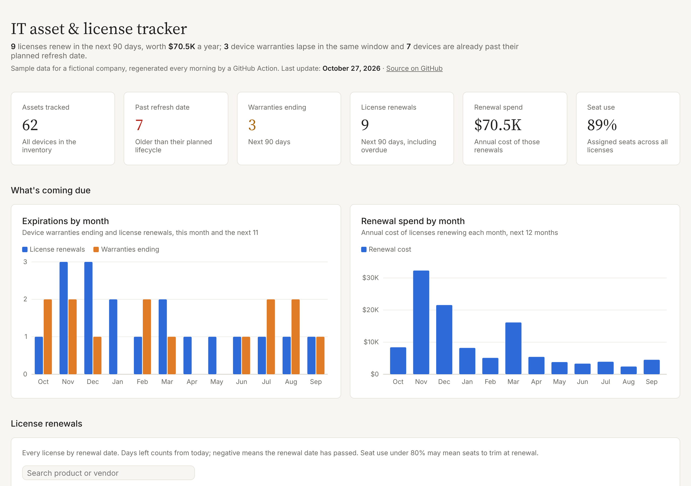

# IT Asset & License Tracker

A dashboard that tracks hardware lifecycles, warranty expirations and software license renewals in one place, so an IT team can see what's coming due before it becomes a problem. The sample data changes every day: a GitHub Action moves the fictional company forward one day each morning and redeploys the page.

**[View the live dashboard](https://raulit-eng.github.io/it-license-lifecycle-dashboard/)**



## What it answers

| Question | Where on the dashboard |
|---|---|
| What renews in the next 90 days, and what will it cost? | Headline tiles, **License renewals** table |
| Which device warranties are about to lapse? | **Expirations by month** chart, **Devices** table |
| Which devices are past their planned refresh date? | **Lifecycle stage by category**, **Devices** table |
| Are we paying for seats nobody uses? | **Seat use** column (under 80% is flagged as a true-up opportunity) |
| When are the expensive months for renewals? | **Renewal spend by month** |
| What changed recently? | **Recent activity** feed |

Every status is calculated from today's date when the page opens, so "days left" and "due within 30 days" are always current.

## How it updates every day

```
scripts/evolve.py  ──►  data/assets.csv, data/licenses.csv, data/activity.json  ──►  index.html
(daily simulation)        (committed by the GitHub Action)                          (reads the CSVs in the browser)
```

Each morning `.github/workflows/daily-data.yml` runs the simulator, which:

- **Replaces devices past their refresh date**, a few at a time, with current models
- **Adds new equipment** now and then (new hires, extra monitors) and retires old spares
- **Renews licenses** on their renewal date: auto-renew contracts always, the rest within a few days of lapsing, with a small price increase and seats trimmed to actual usage when utilization is under 80%
- **Moves seat usage** up and down a little, and devices in and out of repair

The run is seeded by the date, so re-running a day gives the same result. Every change is logged to `data/activity.json` and shown in the **Recent activity** feed. You can also trigger a run by hand from the repo's **Actions** tab (Daily data & deploy → Run workflow).

## Using it with real data

Replace the two CSV files with an export from your asset system (Snipe-IT, Intune, Lansweeper, a spreadsheet) and your license register, keeping the same column names:

- **`data/assets.csv`**: `asset_tag, name, category, department, location, purchase_date, warranty_end, lifecycle_end, cost, status`
- **`data/licenses.csv`**: `license_id, product, vendor, license_type, seats_total, seats_used, renewal_date, annual_cost, auto_renew, owner_department`

Then delete the "Generate today's data" step from the workflow so the simulator stops changing them. Refresh cycles by device type are set in `scripts/evolve.py` (`LIFE` and `WARR`): laptops 4 years, desktops and servers 5, network gear and monitors 6, phones 3.

## Run it locally

```bash
python3 -m http.server 8000      # then open http://localhost:8000
python3 scripts/evolve.py data/assets.csv data/licenses.csv /tmp/out 2026-10-28 data/activity.json   # simulate a day
```

No build step and no server code: one HTML page, a small data runtime (`assets/dash-runtime.js`) and D3.js for the charts. It works in light and dark mode and on phones.

## Built with

HTML, CSS, JavaScript and [D3.js](https://d3js.org) for the dashboard; Python for the data simulation; GitHub Actions and GitHub Pages for the daily updates and free hosting. All companies, devices and figures are randomly generated.

Related: [it-asset-tracker](https://github.com/raulit-eng/it-asset-tracker), a SQLite and SQL reporting project for a 1,250-device fleet.
